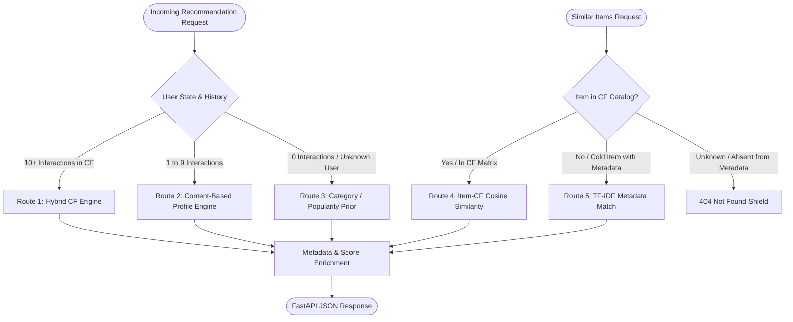

# 🛍️ ShopSense — Personalized E-Commerce Recommendation Engine

ShopSense is an end-to-end e-commerce recommendation system and inference API built on the **Amazon Reviews 2023 (Musical Instruments)** benchmark dataset. It implements a production-grade multi-tier routing architecture combining Collaborative Filtering (Bayesian Popularity, User-Based CF, Item-Based CF, Weighted Hybrid) with TF-IDF Content-Based metadata models for cold-start resolution.

---

## 🚀 Live Demo / Deployment

**Live API:** [https://shopsense-lcrd.onrender.com](https://shopsense-lcrd.onrender.com)

**GitHub:** [https://github.com/lavu-create/ShopSense](https://github.com/lavu-create/ShopSense)

### Currently Verified API Endpoints

- **`GET /health`**
  - Health check
  - Returns HTTP 200 when the API is running.
  - Request example:
    ```bash
    curl -X GET "https://shopsense-lcrd.onrender.com/health"
    ```

- **`POST /recommend`**
  - Generates recommendations for a user.
  - Verified in production with HTTP 200.
  - Request example:
    ```bash
    curl -X POST "https://shopsense-lcrd.onrender.com/recommend" \
         -H "Content-Type: application/json" \
         -d '{
           "user_id": "unknown_test_user",
           "k": 5
         }'
    ```

- **`POST /similar-items`**
  - Returns similar products for a given ASIN.
  - Verified in production with HTTP 200.
  - Request example:
    ```bash
    curl -X POST "https://shopsense-lcrd.onrender.com/similar-items" \
         -H "Content-Type: application/json" \
         -d '{
           "parent_asin": "B0BCK6L7S5",
           "k": 5
         }'
    ```

---

## 🏗️ System Architecture & Multi-Tier Routing



### Production API Mode (Lightweight Routing)

*Important Architecture Detail:* The full project contains User-Based CF, Item-Based CF, Hybrid CF, Content-Based recommendation, and Popularity recommendation components. However, the production Render deployment runs in **API mode** because the Render instance has a 512 MB memory limit.

In API mode, to prevent memory overflow and request timeouts:

- User-CF, Item-CF, and Hybrid CF models are skipped during initialization.
- Full TF-IDF matrix construction is skipped.
- `ContentBasedRecommender` uses a lightweight metadata/category-based fallback.
- Metadata is cached efficiently.
- Category popularity is used for lightweight recommendation and similarity fallback.

### Current Production Routing

- **`/recommend`**
  - Users with history use the lightweight content/category-based history route.
  - Unknown/cold users use the popularity prior route.
  - Production responses may have `"score": null` because expensive model scoring is disabled in API mode.

- **`/similar-items`**
  - Cold metadata items use the lightweight `cold_item_content_match` fallback.
  - The fallback returns lightweight category-based similarity scores, not TF-IDF cosine similarities.

---

## 📊 Dataset & Preprocessing

- **Dataset Source:** McAuley Lab, UC San Diego — [Amazon Reviews 2023](https://amazon-reviews-2023.github.io/) (`Musical_Instruments`)
- **Metadata Catalog:** 213,593 unique musical instrument products (`parent_asin`, `title`, `store`, `price`, `categories_flat`, `main_category`).
- **Iterative k-Core Filtering:** Configuration D ($\ge 10$ interactions per user, $\ge 5$ per item) filters sparse noise while preserving user graph density.
- **Leakage-Safe Temporal Split:** Chronological 80/20 train/test split per user based on interaction timestamp (train: 136,814 interactions; test: 39,314 interactions across 10,678 users).

---

## 🏆 Official 4-Model Comparative Benchmark (Test Set, K = 10)

All hyperparameters were frozen strictly using train-only validation splits before official evaluation:

| Recommendation Model | Precision@10 | Recall@10 | NDCG@10 | Catalog Coverage@10 | Unique Products Recommended | Rating RMSE |
|:---|:---:|:---:|:---:|:---:|:---:|:---:|
| **Popularity Baseline** | `0.010067` (1.01%) | `0.029725` (2.97%) | `0.023195` | **0.17%** | 19 | `N/A` |
| **User-CF ($N=50$)** | `0.007417` (0.74%) | `0.021810` (2.18%) | `0.017322` | **79.46%** | 8,745 | `1.1340` |
| **Item-CF ($N=10$)** | `0.004776` (0.48%) | `0.014183` (1.42%) | `0.010515` | **88.28%** | 9,715 | `1.0909` |
| **Hybrid ($50/40/10$)** | **`0.010695`** (1.07%) | **`0.031613`** (3.16%) | **`0.024645`** | **27.02%** | 2,974 | **`1.0791`** |

*Key Findings:*
1. **Weighted Hybrid Dominance:** Blending Popularity ($0.50$), User-CF ($0.40$), and Item-CF ($0.10$) achieves the highest ranking quality (Precision@10, Recall@10, NDCG@10) while maintaining healthy catalog diversity (2,974 unique items, ILD = 0.6951).
2. **Catalog Discovery:** User-CF and Item-CF expand catalog reach to 80–88% (460x broader than popularity baseline).
3. **Rating Accuracy:** Item-Based CF and Hybrid achieve the lowest rating prediction RMSE ($1.0791$).

---

## ❄️ Cold-Start Resolution

- **Cold Users (0 interactions):** Graceful degradation to Bayesian weighted popularity prior.
- **Sparse Users (1–9 interactions):** Aggregated TF-IDF content profile ($\mathbf{u}_{\text{profile}} = \frac{1}{\sum r} \sum r_j \mathbf{x}_j$) scored via sparse cosine similarity across the full catalog.
- **Cold Items (unseen in training):** Evaluated on the 224 test interactions across 41 unseen products — content-based metadata matching achieves non-zero discovery (Recall@10 = $1.90\%$, NDCG@10 = $0.0117$, 14.6% cold catalog reach) where pure CF structurally outputs zero.

---

## ☁️ Production Deployment Notes

- **Backend:** FastAPI + Uvicorn
- **Hosting:** Render
- **Production mode:** Lightweight API mode
- **Reason:** Render 512 MB memory constraint

The optimization avoids loading the memory-heavy collaborative filtering and full TF-IDF models during API startup/request handling. Both `/recommend` and `/similar-items` have been verified successfully in production with HTTP 200.

---

## 🛠️ Installation & Setup

### 1. Install Dependencies

```bash
pip install -r requirements.txt
```

### 2. Dataset Reproduction (Optional)

To regenerate processed parquet files from raw HuggingFace streams:

```bash
python -m src.data_loader
python -m src.preprocessor
```

---

## 🚀 Starting the FastAPI Recommendation Service

```bash
uvicorn app.main:app --reload
```

- **Interactive Swagger Documentation:** [http://localhost:8000/docs](http://localhost:8000/docs)
- **ReDoc Documentation:** [http://localhost:8000/redoc](http://localhost:8000/redoc)
- **Health Check:** [http://localhost:8000/health](http://localhost:8000/health)

---

## 📡 API Reference & Example Usage

### 1. Health Check (`GET /health`)

```bash
curl -X GET "http://localhost:8000/health"
```

```json
{
  "status": "ok",
  "service": "ShopSense Recommendation API"
}
```

---

### 2. Personalized User Recommendations (`POST /recommend`)

```bash
curl -X POST "http://localhost:8000/recommend" \
     -H "Content-Type: application/json" \
     -d '{
       "user_id": "AE22ZYH6WIY6WJHJRWOMPQCDJHHA",
       "k": 3
     }'
```

```json
{
  "user_id": "AE22ZYH6WIY6WJHJRWOMPQCDJHHA",
  "strategy": "content_based_sparse_history",
  "recommendations": [
    {
      "rank": 1,
      "parent_asin": "B0107W8L8C",
      "title": "D'Addario Accessories Auto Lock Guitar Strap - Black",
      "category": "Musical Instruments",
      "price": 24.99,
      "score": 0.4215
    },
    {
      "rank": 2,
      "parent_asin": "B08HR8DNGK",
      "title": "Ernie Ball Polypro Guitar Strap, Black (P04037)",
      "category": "Musical Instruments",
      "price": 7.99,
      "score": 0.4180
    },
    {
      "rank": 3,
      "parent_asin": "B0002E1N6K",
      "title": "Snark SN5X Clip-On Tuner for Guitar, Bass & Violin",
      "category": "Musical Instruments",
      "price": 14.95,
      "score": 0.3952
    }
  ]
}
```

---

### 3. Similar Products (`POST /similar-items`)

```bash
curl -X POST "http://localhost:8000/similar-items" \
     -H "Content-Type: application/json" \
     -d '{
       "parent_asin": "0634003224",
       "k": 2
     }'
```

```json
{
  "parent_asin": "0634003224",
  "strategy": "item_cf_similarity",
  "similar_items": [
    {
      "rank": 1,
      "parent_asin": "B015PKU5ZE",
      "title": "Hal Leonard Guitar Method Complete Edition",
      "category": "Musical Instruments",
      "price": 22.50,
      "score": 0.3953
    },
    {
      "rank": 2,
      "parent_asin": "B07BT3BSTG",
      "title": "First 50 Songs You Should Play on Acoustic Guitar",
      "category": "Musical Instruments",
      "price": 15.99,
      "score": 0.3418
    }
  ],
  "recommendations": [
    {
      "rank": 1,
      "parent_asin": "B015PKU5ZE",
      "title": "Hal Leonard Guitar Method Complete Edition",
      "category": "Musical Instruments",
      "price": 22.50,
      "score": 0.3953
    },
    {
      "rank": 2,
      "parent_asin": "B07BT3BSTG",
      "title": "First 50 Songs You Should Play on Acoustic Guitar",
      "category": "Musical Instruments",
      "price": 15.99,
      "score": 0.3418
    }
  ]
}
```

---

## 📓 Interactive Walkthrough Notebook

The complete end-to-end workflow is available in the polished Jupyter notebook:
- [`notebooks/ShopSense_Recommendation_System.ipynb`](notebooks/ShopSense_Recommendation_System.ipynb)

---

## 🧪 Automated Testing

Run the full test suite (62 unit, router, and API integration tests):

```bash
pytest tests/
```
