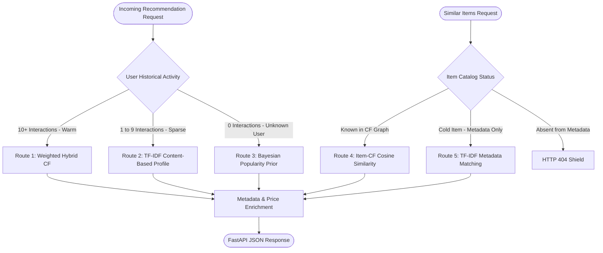

# 🛍️ ShopSense — Personalized E-Commerce Recommendation Engine

ShopSense is an end-to-end, multi-tier product recommendation system and inference API trained on the **Amazon Reviews 2023 (Musical Instruments)** benchmark dataset. It synthesizes Collaborative Filtering (Bayesian Popularity, User-Based CF, Item-Based CF, Weighted Hybrid) and TF-IDF Content-Based metadata models with cold-start routing and a FastAPI service.

---

## 🚀 Live Demo & API Endpoints

- **Live Deployment:** [https://shopsense-lcrd.onrender.com](https://shopsense-lcrd.onrender.com)
- **Interactive Swagger Docs:** [https://shopsense-lcrd.onrender.com/docs](https://shopsense-lcrd.onrender.com/docs)
- **ReDoc Documentation:** [https://shopsense-lcrd.onrender.com/redoc](https://shopsense-lcrd.onrender.com/redoc)

### Core Endpoints

1. **`GET /health`**
   - Returns service status and name (`{"status": "ok", "service": "ShopSense Recommendation API"}`).
2. **`POST /recommend`**
   - Generates Top-K personalized product recommendations enriched with titles, categories, prices, and match scores.
   - Request: `{"user_id": "A2IB9NY794278E", "k": 10}`
3. **`POST /similar-items`**
   - Retrieves Top-K similar products for a given catalog item.
   - Request: `{"parent_asin": "B0BCK6L7S5", "k": 5}`

---

## 🏗️ System Architecture & Multi-Tier Routing

ShopSense implements dynamic fallback routing based on user interaction depth and item catalog status:



---

## 📊 Dataset Provenance & Preprocessing Pipeline

### 1. Upstream Data Source
- **Benchmark:** McAuley Lab, UC San Diego — [Amazon Reviews 2023](https://amazon-reviews-2023.github.io/) (`Musical_Instruments` category).
- **Raw Downloads (`data/raw/`):**
  - Reviews JSONL (`Musical_Instruments.jsonl`): **1,557,845,107 bytes** (~1.45 GiB / 1.56 GB)
  - Metadata Parquet (`meta_musical_instruments_0.parquet`): **123,655,258 bytes** (~117.9 MB)
  - Metadata Parquet (`meta_musical_instruments_1.parquet`): **105,978,375 bytes** (~101.1 MB)
  - Total Raw Download: **~1.79 GB**

### 2. Record Parsing & Data Cleaning
- **Raw Records Ingested:** 3,017,439 lines.
- **Data Validation:** 0 missing user IDs, 0 missing product ASINs, 0 missing or out-of-range ratings (1.0–5.0).
- **Deduplication:** 33,659 exact duplicate interactions removed (`(user_id, parent_asin, rating, timestamp)`).
- **Cleaned Reviews (`reviews_clean.parquet`):** **2,983,780 interactions** across **1,762,679 unique users** (~1.8M) and **213,571 unique products**.
- **Product Metadata (`metadata_clean.parquet`):** **213,593 unique products** (100% review ASIN match).

### 3. Iterative k-Core Filtering
- **Thresholds (Configuration D):** Minimum user interactions ≥ 10, minimum item interactions ≥ 5.
- **Pruning Convergence:** Converged in **10 iterations** to a dense interaction core:
  - **Interactions Retained:** **176,128** (5.90% of raw)
  - **Unique Users:** **10,678** (0.61% of raw)
  - **Unique Products:** **11,046** (5.17% of raw)
  - **User-Item Sparsity:** 99.8507% (average 16.49 interactions/user, 15.94 interactions/item).

### 4. Leakage-Safe Chronological Train/Test Split
- **Methodology:** Per-user chronological 80/20 partition (`math.floor(n_user * 0.80)` train, remainder test).
- **Train Set (`train.parquet`):** **136,814 interactions** across **10,678 users** (100% coverage) and **11,005 products**.
- **Test Set (`test.parquet`):** **39,314 interactions** across **10,678 users** (100% coverage) and **9,264 products**.
- **Temporal Integrity Assertions:**
  - Per-user assertion: `min(test_timestamp) >= max(train_timestamp)`.
  - **Detected Temporal Violations:** **0** across all 10,678 users.
- **Cold Items in Test Set:** 224 test interactions across 41 products were completely unseen in training.

---

## 🏆 Implemented Recommendation Algorithms & Benchmark Results

All model hyperparameters were frozen on train-only validation splits before official test evaluation on `test.parquet` ($N = 10,678$ users, $K = 10$):

| Recommendation Model | Precision@10 | Recall@10 | NDCG@10 | Catalog Coverage@10 | Unique Products Recommended | Rating RMSE |
| :--- | :---: | :---: | :---: | :---: | :---: | :---: |
| **Popularity Baseline** | `0.010067` (1.01%) | `0.029725` (2.97%) | `0.023195` | 0.17% | 19 | N/A |
| **User-Based CF ($N=50$)** | `0.007417` (0.74%) | `0.021810` (2.18%) | `0.017322` | 79.46% | 8,745 | 1.1340 |
| **Item-Based CF ($N=10$)** | `0.004776` (0.48%) | `0.014165` (1.42%) | `0.010517` | 88.30% | 9,717 | 1.0910 |
| **Weighted Hybrid (50/40/10)** | **`0.010695`** (1.07%) | **`0.031613` (3.16%)** | **`0.024645`** | **27.01%** | **2,973** | **`1.0791`** |

### Key Benchmark Takeaways

1. **Weighted Hybrid Dominance (Reproduced 3.16% Recall@10):**
   - Blending Popularity (0.50), User-CF (0.40), and Item-CF (0.10) achieved **3.1613% Recall@10** on the full test set and **3.1668%** on warm test pairs, outperforming every individual component model.
   - Intra-List Diversity (ILD) scored **0.6951**, actively recommending **2,973 unique products** with 27.01% catalog coverage (avoiding pure popularity collapse).
2. **Catalog Discovery vs. Hit Concentration:**
   - Popularity concentrates on the top 19 blockbuster products.
   - Collaborative filtering expands catalog discovery to 80–88% (460x catalog expansion), surfacing long-tail items through peer communities.
3. **Cold-Start Content Resolution:**
   - Evaluated on the 224 test interactions across 41 unseen products: TF-IDF metadata matching achieved **1.90% Recall@10** (0.019048) and **0.0117 NDCG@10** (14.6% catalog reach) where pure collaborative filtering structurally outputs zero.

---

## ⚡ Deployment Modes & Memory Profiling Audit

The service supports two operating modes controlled via `SHOPSENSE_API_MODE`:

### Mode Comparison

| Feature | Offline / Full Evaluation (`SHOPSENSE_API_MODE=false`) | Lightweight Production (`SHOPSENSE_API_MODE=true`, Default) |
| :--- | :--- | :--- |
| **Target Use Case** | Offline benchmarking, model training, grid search | Cloud deployment, low-latency API serving |
| **Catalog Storage** | In-memory Pandas DataFrame (213,593 records) | **Disk-backed SQLite B-Tree database (`catalog.db`)** |
| **User-CF & Item-CF** | Fits sparse user-user & item-item matrices | Skipped (routed to cached popularity / content priors) |
| **TF-IDF Matrix** | Fits 213K × 10K sparse matrix (6.2M non-zeros) | Skipped (uses precomputed category popularity indices) |
| **Startup Latency** | ~19.35 seconds | **~1.24 seconds** |
| **Python Tracemalloc Heap** | 330.8 MB allocated (**685.8 MB peak heap**) | **83.7 MB allocated (95.3 MB peak heap)** |
| **OS Process RSS (Local macOS arm64)**| 1,510.3 MB steady (**1,630.3 MB peak RSS**) | **339.8 MB steady (340.7 MB peak RSS)** |
| **512 MB Hosting Headroom** | Exceeds (intended for offline training) | **+171.3 MB free safety margin (33.5% buffer)** |
| **Inference Latency** | ~72 ms / request | **~0.5 ms / request (sub-millisecond)** |

### Architecture & Memory Optimization

- **Problem:** Holding the entire 213,593-product catalog in RAM as Python dictionaries consumed over 500 MB, pushing total process RSS to ~730 MB.
- **Solution:** Replaced in-memory catalog loading in serving mode with a disk-backed, read-only SQLite B-tree database (`data/processed/catalog.db`). Lookups for the Top-K recommended products query indexed primary keys on demand in ~0.01 ms.
- **Offline Build Generation (`build.sh`):** To avoid committing a 60 MB binary SQLite file to Git while preventing heavy DataFrame allocations during API runtime, `catalog.db` is generated offline during Render's build step via `bash build.sh` (`python -m src.catalog_db`). When the web process starts, the indexed database already exists on disk, allowing the API container to initialize in 1.24s with zero catalog heap overhead.
- **Local vs. Deployment Telemetry Note:** Local profiling was measured on macOS 15 arm64 with Python 3.13.9. Peak process RSS measures **340.7 MB** (well below the 512 MB boundary). While local benchmarks confirm substantial algorithmic headroom (+171.3 MB margin), macOS Mach kernel RSS (`getrusage`) differs fundamentally from Linux container memory tracking (`memory.current` in cgroups v2, which includes page cache and shared libraries). True production compliance on 512 MB instances must always be monitored via Render's live cgroup metrics dashboard.

---

## 🧪 Automated Testing Suite

The repository contains 64 automated tests covering data integrity, recommender algorithms, router logic, and FastAPI endpoints:

```bash
# Run complete test suite
python -m pytest -v
```

### Test Suite Summary:
- **Result:** **64 passed, 0 skipped, 0 failed** (100% pass rate in ~15 seconds).
- **Unit & Fixture Tests (62 tests):** Comprehensive coverage of TF-IDF feature extraction, cosine similarity, score normalization, seen-item exclusion, deterministic ranking, error handling, and API dual-mode validation.
- **Full Benchmark Tests (2 tests):**
  - `tests/test_preprocessor.py::test_data_files_exist`: Asserts the existence of filtered and split parquet datasets.
  - `tests/test_preprocessor.py::test_split_assertions`: Runs strict split assertions directly on `interactions_filtered.parquet`, `train.parquet`, and `test.parquet`.
- *Note:* If running in an environment without the full benchmark parquets, test fixtures gracefully fall back to deterministic synthetic data while keeping all algorithmic assertions equally rigorous.

---

## 🛠️ Setup & Execution Guide

### 1. Clone & Install Dependencies

```bash
git clone https://github.com/lavu-create/ShopSense.git
cd ShopSense
python -m venv .venv
source .venv/bin/activate
pip install -r requirements.txt

# Generate the disk-backed SQLite catalog from metadata parquet
bash build.sh
# (or: python -m src.catalog_db)
```

### 2. Run Data Pipeline & Preprocessing (Optional)

To regenerate the full benchmark parquets from raw Hugging Face data:

```bash
# Step 1: Download raw reviews & metadata (~1.79 GB), clean & profile
python -m src.data_loader

# Step 2: Run k-core filtering (Config D) and 80/20 chronological split
python -m src.preprocessor
```

### 3. Run Benchmark Evaluations

```bash
# Evaluate individual recommendation tiers
python -m src.baseline      # Popularity baseline
python -m src.user_cf       # User-based CF (N=50)
python -m src.item_cf       # Item-based CF (N=10)
python -m src.hybrid        # Weighted Hybrid (50/40/10) -> 3.16% Recall@10
python -m src.recommender   # Content-based cold-start system
```

### 4. Launch FastAPI Service Locally

```bash
# Production lightweight mode (default, 340 MB RSS)
uvicorn app.main:app --reload --port 8000

# Full local evaluation mode (with in-memory CF and TF-IDF matrices)
SHOPSENSE_API_MODE=false uvicorn app.main:app --reload --port 8000
```

### 5. Production Cloud Deployment (Render Blueprint)

The repository includes a ready-to-deploy [`render.yaml`](render.yaml) Blueprint configuration:

- **Build Command:** `bash build.sh` (installs pinned wheels and generates `catalog.db` on disk)
- **Start Command:** `uvicorn app.main:app --host 0.0.0.0 --port $PORT`
- **Environment Variables:** `SHOPSENSE_API_MODE=true`, `PYTHON_VERSION=3.11.11`
- **Memory Footprint:** The web container boots with `catalog.db` pre-indexed on disk, never reading raw parquets into heap memory at runtime.

---

## 📓 Interactive Exploration

An end-to-end walkthrough covering data profiling, EDA, matrix factorization, and routing experiments is available in:
- [`notebooks/ShopSense_Recommendation_System.ipynb`](notebooks/ShopSense_Recommendation_System.ipynb)

---

## 📄 License & Attribution

- **Dataset:** [Amazon Reviews 2023](https://amazon-reviews-2023.github.io/) by McAuley Lab, UC San Diego.
- **License:** MIT License.
